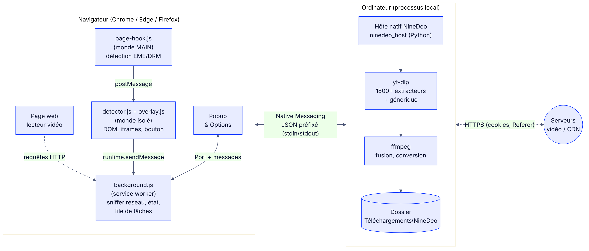
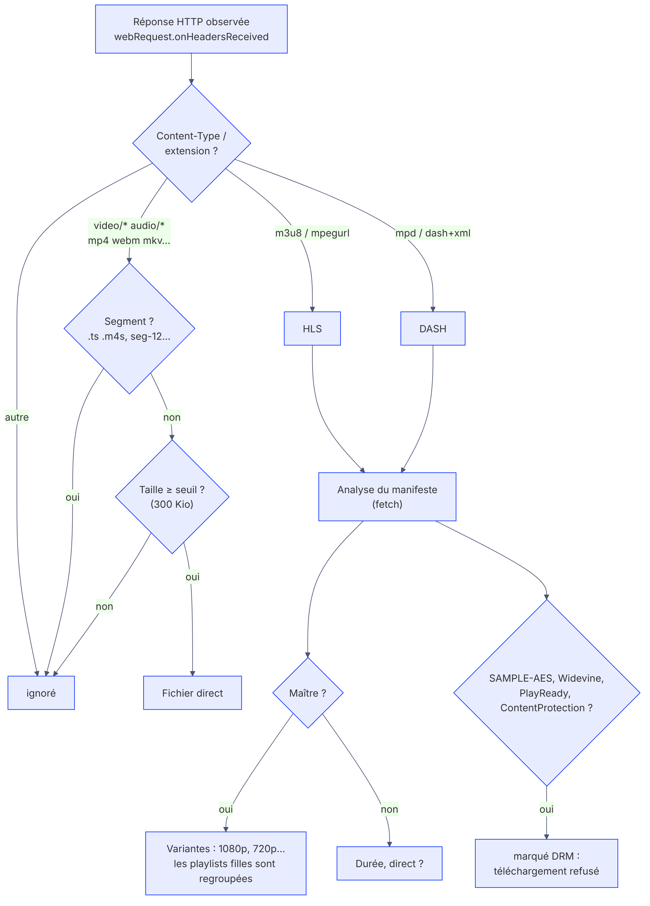
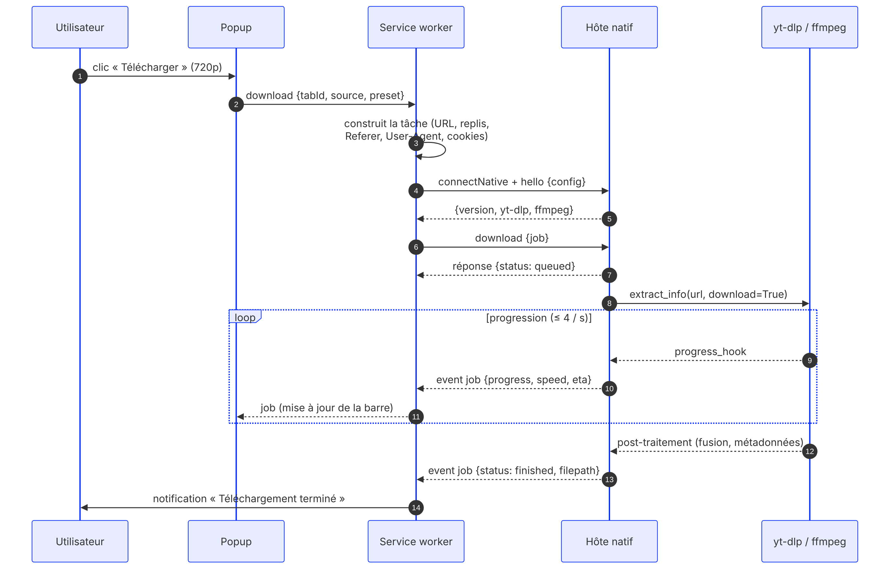

# NineDeo — Documentation technique

*Version 1.0.0 — octobre 2026*

## Sommaire

1. [Objectif et cahier des charges](#1-objectif-et-cahier-des-charges)
2. [Choix d'architecture](#2-choix-darchitecture)
3. [Vue d'ensemble](#3-vue-densemble)
4. [L'extension navigateur](#4-lextension-navigateur)
5. [L'hôte natif](#5-lhôte-natif)
6. [Protocole extension ↔ hôte](#6-protocole-extension--hôte)
7. [Déroulement d'un téléchargement](#7-déroulement-dun-téléchargement)
8. [Gestion des DRM](#8-gestion-des-drm)
9. [Sécurité et vie privée](#9-sécurité-et-vie-privée)
10. [Installation et déploiement](#10-installation-et-déploiement)
11. [Tests](#11-tests)
12. [Limites connues et évolutions](#12-limites-connues-et-évolutions)
13. [Annexes](#13-annexes)

---

## 1. Objectif et cahier des charges

NineDeo est un outil de téléchargement de vidéos utilisé depuis le navigateur, dans l'esprit des extensions de type « Video Downloader ». L'exigence principale : **la solution doit fonctionner sur n'importe quel site**, à l'exception des contenus protégés par DRM (Netflix, Disney+, Prime Video…), qui sont exclus.

| Exigence | Réponse apportée |
|---|---|
| Fonctionner sur n'importe quel site | Trois mécanismes se complètent : yt-dlp (extracteurs dédiés et générique), sniffing réseau des flux réellement lus, et repli automatique de l'un à l'autre |
| Formats modernes (HLS, DASH) | Analyse des manifestes dans l'extension ; téléchargement des segments, déchiffrement AES-128 et fusion par yt-dlp + ffmpeg |
| Choix de la qualité | Préréglages (meilleure, 2160p … 360p, audio) et formats exacts issus de l'analyse |
| Ergonomie | Popup, bouton sur la vidéo, menu contextuel, raccourcis, notifications |
| Contenus DRM exclus | Détection (EME, manifestes) ; refus explicite côté extension et côté hôte |
| Multi-navigateurs | Manifest V3 commun Chrome / Edge / Firefox ; installeur qui déclare l'hôte pour tous |

## 2. Choix d'architecture

Quatre architectures ont été comparées :

| Option | Avantages | Inconvénients |
|---|---|---|
| Extension seule | Rien à installer à côté | Service worker MV3 arrêté après ~30 s d'inactivité ; mux DASH/HLS à refaire en JS ou ffmpeg.wasm (lourd) ; aucun extracteur par site |
| Application de bureau seule | Robuste | Il faut copier les URL à la main, et la détection des flux joués par le navigateur est perdue |
| **Extension + hôte natif (retenue)** | La détection se fait dans le navigateur, là où les flux sont visibles ; le téléchargement est fait par des outils natifs éprouvés, sans limite de durée ni de mémoire | Un programme local à installer |
| Service web | Aucune installation | Serveur et bande passante à financer, et responsabilité sur les contenus qui transitent |

L'architecture retenue répartit le travail selon les forces de chaque composant. Le navigateur voit les requêtes et les cookies ; l'hôte dispose de yt-dlp (plus de 1 800 extracteurs maintenus par la communauté) et de ffmpeg.

## 3. Vue d'ensemble



| Composant | Technologie | Rôle |
|---|---|---|
| `content/page-hook.js` | JS, monde `MAIN`, `document_start` | Intercepte `requestMediaKeySystemAccess` et `setMediaKeys` (détection EME/DRM) |
| `content/drm-bridge.js` | JS, monde isolé, `document_start` | Relaie ces signaux au service worker |
| `content/detector.js` | JS, monde isolé, toutes frames | Médias du DOM, Open Graph, iframes contenant un lecteur |
| `content/overlay.js` | JS, Shadow DOM | Bouton « Télécharger » au survol des vidéos |
| `background.js` | Service worker MV3 (Chrome) / script de fond (Firefox) | Sniffer réseau, analyse des manifestes, état par onglet, file de tâches, connexion à l'hôte |
| `popup/`, `options/` | HTML/CSS/JS sans framework | Interface |
| `host/ninedeo/` | Python ≥ 3.9 | Protocole Native Messaging, file de téléchargements, pilotage de yt-dlp |
| yt-dlp + ffmpeg | Bibliothèque Python / binaire | Extraction, téléchargement segmenté, fusion, conversion |

## 4. L'extension navigateur

### 4.1 Manifeste (Manifest V3)

Un **manifeste unique** sert à tous les navigateurs :

- `background.service_worker` est lu par Chrome/Edge, `background.scripts` par Firefox. Chacun ignore la clé de l'autre.
- `key` contient une clé publique RSA, ce qui fixe l'identifiant de l'extension à `hcijkjkgdbihledmefkjiafcejmcgjom` même en mode non empaqueté. L'installeur peut donc autoriser cet identifiant à l'avance.
- `browser_specific_settings.gecko.id = ninedeo@ninedeo.app` remplit le même rôle pour Firefox.

Permissions et justification :

| Permission | Usage |
|---|---|
| `nativeMessaging` | Dialogue avec l'hôte |
| `webRequest` + `<all_urls>` | Observer les en-têtes des réponses (mode non bloquant) pour repérer les médias |
| `webNavigation` | Réinitialiser la liste des médias à chaque nouvelle page |
| `tabs` | Titre et URL de l'onglet (nom du fichier, Referer) |
| `cookies` | Transmettre les cookies du site au moteur (vidéos derrière une connexion) |
| `storage` | Réglages (`sync`), historique (`local`), état des onglets (`session`) |
| `contextMenus`, `notifications`, `downloads` | Menu clic droit, notifications de fin, téléchargement direct de secours sans moteur |

### 4.2 Détection des médias



**Réseau** (`webRequest.onHeadersReceived`). Chaque réponse 2xx est classée par `NineDeo.classify(url, contentType)` (`shared/util.js`) :

- **HLS** : `Content-Type` `application/vnd.apple.mpegurl`, `application/x-mpegurl`… ou extension `.m3u8`.
- **DASH** : `application/dash+xml` ou extension `.mpd`.
- **Fichier** : `video/*`, `audio/*`, ou extension média connue servie en `application/octet-stream`.
- **Ignoré** : segments (`video/mp2t`, `.ts`, `.m4s`, motifs `seg-12`, `chunk_3`, `init.mp4`…), morceaux de `googlevideo.com` avec `range=`, fichiers plus petits que le seuil réglable (300 Kio par défaut : aperçus, publicités courtes). La taille est lue dans `Content-Range` (`bytes 0-1/123456`) quand le lecteur ne demande qu'une plage.

Les entrées sont dédoublonnées par URL. Pour les fichiers, l'URL est normalisée (suppression de `range`, `bytes`, `start`…) afin qu'un même fichier lu par morceaux n'apparaisse qu'une fois.

**Manifestes.** Chaque manifeste détecté est relu par le service worker (`fetch` avec les cookies, délai maximal de 8 s) :

- HLS maître (`#EXT-X-STREAM-INF`) : variantes (résolution, débit, codecs). Les playlists filles déjà vues, ou vues plus tard, sont rattachées au maître et masquées.
- HLS média : durée (somme des `#EXTINF`), direct (absence de `#EXT-X-ENDLIST`).
- DASH : hauteurs des `Representation`, `mediaPresentationDuration`, `type="dynamic"`.
- Recherche d'indices DRM (voir §8).

**DOM** (`detector.js`, toutes les frames). Lit `currentSrc`, `src` et `<source>` des éléments `<video>`/`<audio>` (les URL `blob:` issues de Media Source Extensions sont ignorées : le flux réel est capté côté réseau), ainsi que `og:video` et `twitter:player:stream`. L'analyse est relancée sur `play`, `loadedmetadata` et via un `MutationObserver`, avec un délai anti-rebond. Une frame secondaire contenant une `<video>` est mémorisée comme **lecteur intégré** et sert ensuite de source de repli.

**Classement.** Les flux sont triés par pertinence : HLS maître > DASH > HLS média > fichier vidéo > audio, avec un bonus pour la résolution et la taille et une pénalité pour les DRM.

### 4.3 État et persistance

| Donnée | Stockage | Raison |
|---|---|---|
| Médias par onglet | `Map` en mémoire + `storage.session` | Le service worker MV3 peut être arrêté à tout moment ; l'état est restauré au réveil |
| Historique des téléchargements | `storage.local` (200 entrées par défaut) | Persiste après la fermeture du navigateur ; **sans les cookies** |
| Réglages | `storage.sync` | Synchronisés entre les postes du même compte |

Au redémarrage, une tâche restée « active » passe à l'état **interrompue**. La reprise renvoie la même spécification à l'hôte, en réutilisant le même nom de fichier, et yt-dlp repart du fichier `.part`.

### 4.4 Connexion à l'hôte

- `runtime.connectNative("com.ninedeo.host")` à la première demande, suivi de `hello` avec la configuration.
- Tant que le port est ouvert, Chrome (version 105 et suivantes) **garde le service worker en vie** : les événements de progression ne sont pas perdus.
- Le port est fermé après **2 minutes d'inactivité** (aucune tâche active, aucune popup ouverte) pour libérer le processus.
- Erreurs distinguées : `missing` (hôte non déclaré), `exited`, `forbidden`, et affichage correspondant dans la popup.

### 4.5 Construction d'une tâche (`startDownload`)

Trois types de source :

1. **Page** (`{type:"page"}`) : URL de la page envoyée à yt-dlp. Les replis sont ajoutés dans cet ordre : URL des iframes contenant un lecteur, puis les 3 meilleurs flux détectés (`kind: "media"`).
2. **Flux** (`{type:"item"}`) : un manifeste ou un fichier détecté. En-têtes `Referer`, `Origin` et `User-Agent` du navigateur ; titre = titre de l'onglet (suffixe « - NomDuSite » retiré) + qualité.
3. **URL** (`{type:"url"}`) : depuis le menu contextuel (`srcUrl`, `linkUrl`).

Les cookies de toutes les URL concernées sont collectés avec `cookies.getAll` puis ajoutés à la spécification envoyée. Ils ne sont **jamais** écrits dans l'historique.

### 4.6 Interface

- **Popup** (400 px) : état du moteur, carte « Cette page » (qualité, analyse yt-dlp, formats exacts), « Flux détectés », onglet « Téléchargements » mis à jour en temps réel par un `Port` dédié.
- **Options** : sections Moteur (versions, test, mise à jour de yt-dlp), Téléchargements, Qualité, Performances, Avancé, Interface, Installation. L'enregistrement est automatique.
- **Bouton sur la vidéo** : `document.elementsFromPoint` retrouve la `<video>` même lorsqu'elle est recouverte par les calques du lecteur. Le rendu se fait dans un Shadow DOM fermé, ce qui l'isole du CSS de la page.
- Couleurs issues du logo (`#0029FF`, `#38BFD6`, `#FF3333`) ; thème sombre automatique.

## 5. L'hôte natif

### 5.1 Modules

| Module | Responsabilité |
|---|---|
| `protocol.py` | Lecture et écriture des messages (longueur sur 4 octets en ordre natif + JSON UTF-8) ; mode binaire sous Windows (`msvcrt.setmode`) ; garde-fou de 1 Mo en sortie |
| `host.py` | Boucle principale, table des commandes, exécution asynchrone des commandes longues (pool de 4 threads), journalisation, `--selftest` |
| `jobs.py` | File d'attente, répartiteur (N téléchargements simultanés), un thread par tâche, hooks de progression, pause, annulation, nettoyage |
| `engine.py` | Options yt-dlp, préréglages → sélecteurs `-f`, fichier de cookies Netscape, analyse (probe), classification des erreurs |
| `config.py` | Réglages validés (bornes, valeurs admises), envoyés par l'extension |
| `system.py` | Chemins (`%LOCALAPPDATA%\NineDeo`), recherche de ffmpeg, ouverture de fichiers, sélecteur de dossier (Tk), registre des fichiers produits |

**Règle critique** : rien d'autre que le protocole ne doit sortir sur `stdout`. `sys.stdout` est redirigé vers `stderr` dès le démarrage, et yt-dlp reçoit un `logger` dédié qui écrit dans `host.log`. Le moindre `print` corromprait sinon le flux et le navigateur couperait la connexion.

### 5.2 Préréglages de qualité

| Préréglage | Sélecteur yt-dlp (ffmpeg présent) |
|---|---|
| Meilleure | `bv*+ba/b` |
| 1080p max (idem 2160, 1440, 720, 480, 360) | `bv*[height<=1080]+ba/b[height<=1080]/bv*+ba/b` |
| Audio MP3 / M4A | `ba/b` (ou `ba[ext=m4a]/ba/b`) + `FFmpegExtractAudio` |
| Format exact | `<id>+ba/<id>` |

Le dernier repli (`/bv*+ba/b`) évite un échec quand la source n'expose pas de hauteur, comme un MP4 direct sans métadonnées. Sans ffmpeg, seuls des formats « tout-en-un » sont demandés (`b[height<=…]/b`).

L'option *Préférer H.264/AAC* ajoute `format_sort = res, fps, vcodec:h264, acodec:aac` : à résolution égale, on choisit le codec le plus compatible.

### 5.3 Exécution d'une tâche

```
candidats = [url principale] + replis
pour chaque candidat :
    construire les options (cookies, en-têtes, nom de fichier, préréglage)
    yt_dlp.YoutubeDL(options).extract_info(url, download=True)
    succès → fin
    erreur « unsupported / 404 / 403 / format » et candidat suivant disponible → avertissement, on continue
    autre erreur → état « error » avec message en français
```

- **Progression** : quand vidéo et audio sont téléchargés séparément, la progression globale est pondérée par la taille de chaque piste (ou répartie à parts égales si les tailles sont inconnues). L'étape affichée est par exemple « Vidéo (1/2) » ou « Fusion audio + vidéo ». Les événements sont limités à 4 par seconde et par tâche.
- **Pause / annulation** : le hook de progression lève `DownloadCancelled`. En pause, les fichiers `.part`, `.ytdl` et `-Frag*` sont conservés. En annulation, ils sont supprimés, avec les pistes intermédiaires `titre.f137.mp4`.
- **Nom de fichier** : pour une page, le modèle yt-dlp configuré (`%(title).180B.%(ext)s` par défaut). Pour un flux direct, le titre de l'onglet, rendu **unique** (« Titre », « Titre (2) »…) au premier lancement puis conservé pour les reprises (`output_base`).
- **Fin de session** : si le navigateur ferme le port pendant un téléchargement, l'hôte termine les tâches en cours avant de quitter. Le fichier reste ainsi complet.

### 5.4 Classification des erreurs

`engine.classify_error` associe un message yt-dlp à un code et à un message lisible : `drm`, `unsupported`, `format_unavailable`, `forbidden` (403), `not_found`, `rate_limited` (429), `auth_required`, `ffmpeg_missing`, `disk_full`, `permission`, `geo_blocked`, `network`, `not_started`. Le message brut reste disponible au survol (`detail`) et dans `host.log`.

## 6. Protocole extension ↔ hôte

Transport Native Messaging : chaque message est un objet JSON précédé de sa longueur (entier 32 bits, ordre natif). Limite : 1 Mo de l'hôte vers le navigateur.

**Requête** (extension → hôte) : `{ "id": "<unique>", "cmd": "<commande>", ...paramètres }`
**Réponse** : `{ "id": "<même id>", "ok": true, "data": ... }` ou `{ "id", "ok": false, "error": { "code", "message", "detail" } }`
**Événement** (hôte → extension, sans id) : `{ "event": "job", "job": { ...état complet } }`

| Commande | Paramètres | Résultat |
|---|---|---|
| `hello` | `config?` | Versions (hôte, yt-dlp, ffmpeg), dossier par défaut, configuration, tâches connues |
| `configure` | `config` | Configuration validée |
| `probe` | `url`, `headers?`, `cookies?` | `{kind: video\|playlist, title, thumbnail, duration, extractor, heights[], formats[]…}` |
| `download` | `job` (voir ci-dessous) | État initial de la tâche |
| `pause` / `resume` / `cancel` / `remove` | `job_id` | État de la tâche |
| `jobs` | — | Liste des tâches |
| `open` / `reveal` | `path` ou `folder: true` | `true` |
| `delete_file` | `path` | `true` |
| `choose_folder` | `initial?` | Chemin choisi ou `null` |
| `update_ytdlp` | — | `{before, after, restart_required}` |

Spécification d'une tâche (`job`) :

```json
{
  "id": "4f1c…", "url": "https://cdn.exemple.fr/master.m3u8", "kind": "media",
  "title": "Conférence d'ouverture (720p)", "preset": "h720", "format_id": null,
  "headers": { "Referer": "https://exemple.fr/live", "Origin": "https://exemple.fr", "User-Agent": "Mozilla/5.0 …" },
  "cookies": [ { "name": "session", "value": "…", "domain": ".exemple.fr", "path": "/", "secure": true, "hostOnly": false, "session": true } ],
  "fallbacks": [ { "url": "https://exemple.fr/live", "kind": "page" } ],
  "page_url": "https://exemple.fr/live"
}
```

États d'une tâche : `queued → starting → downloading → processing → finished`, ou `paused`, `canceled`, `error`. L'extension ajoute `interrupted` (hôte ou navigateur arrêté pendant le téléchargement).

## 7. Déroulement d'un téléchargement



## 8. Gestion des DRM

Conformément au cahier des charges, les contenus protégés sont **exclus**. NineDeo n'implémente aucun mécanisme de contournement (déchiffrement CENC, extraction de clés, CDM). Contourner une mesure technique de protection est d'ailleurs interdit en France (art. L.335-3-1 du Code de la propriété intellectuelle). La détection sert uniquement à informer l'utilisateur et à éviter des échecs incompréhensibles :

| Niveau | Indice | Effet |
|---|---|---|
| Page | `HTMLMediaElement.setMediaKeys(non nul)` intercepté (des clés sont attachées à un lecteur) | Bannière « Ce site lit un contenu protégé par DRM (Widevine) » ; les autres vidéos de la page restent téléchargeables |
| Page | `requestMediaKeySystemAccess` seul | Système mémorisé pour l'affichage, sans alerte (beaucoup de sites testent simplement la disponibilité d'EME) |
| Manifeste HLS | `METHOD=SAMPLE-AES*`, `KEYFORMAT` FairPlay / Widevine / PlayReady | Flux marqué **DRM**, bouton remplacé par un cadenas |
| Manifeste DASH | `<ContentProtection>` avec `schemeIdUri="urn:uuid…"` ou `cenc:default_KID` | Idem |
| Hôte | Formats `has_drm` (yt-dlp) ou message « DRM » | Erreur `drm` explicite |

Le chiffrement HLS **AES-128** n'est pas un DRM : il protège le transport, et la clé est servie en clair au lecteur. Il est géré nativement (un test le vérifie).

## 9. Sécurité et vie privée

- **Surface de l'hôte** : seule l'extension dont l'identifiant figure dans `allowed_origins` / `allowed_extensions` peut le lancer. L'hôte n'ouvre aucun port réseau.
- **Fichiers** : `open`, `reveal` et `delete_file` n'acceptent que des chemins produits par NineDeo (registre `files.json`) ou situés dans le dossier de téléchargement. `open` n'exécute jamais un fichier : seules les extensions média ou image sont ouvertes, tout autre fichier est seulement montré dans l'explorateur.
- **Cookies** : transmis uniquement au processus local, écrits dans un fichier temporaire supprimé à la fin de la tâche, jamais stockés dans l'historique. Option désactivable.
- **Contenu des pages** : le texte des pages n'est jamais inséré en HTML dans l'interface (`textContent` exclusivement). Le bouton est isolé dans un Shadow DOM fermé. Le script `MAIN` n'expose aucune fonction et n'envoie que des indicateurs booléens.
- **Clé privée** de l'extension (`tools/keys/*.pem`) : exclue du dépôt par `.gitignore`. Elle ne sert qu'à empaqueter un `.crx`.
- **Aucune télémétrie.**

## 10. Installation et déploiement

### 10.1 Windows

`installer\windows\install.bat` lance `install.ps1` (sans droits administrateur), qui :

1. trouve Python 3.9+ (`py -3`, `python`) et propose `winget` s'il est absent ;
2. copie l'hôte dans `%LOCALAPPDATA%\NineDeo\host` et crée un venv ;
3. installe `yt-dlp[default,curl-cffi]` ;
4. télécharge ffmpeg (build yt-dlp/FFmpeg-Builds) dans `host\bin` s'il n'est pas dans le `PATH` ;
5. génère `ninedeo-host.bat` et deux manifestes (Chromium : `allowed_origins`, Firefox : `allowed_extensions`) ;
6. déclare l'hôte dans `HKCU\Software\{Google\Chrome, Microsoft\Edge, Chromium, BraveSoftware\Brave-Browser, Mozilla}\NativeMessagingHosts\com.ninedeo.host` ;
7. exécute l'auto-test `--selftest`.

**Variante sans Python** : `build_exe.ps1` construit `ninedeo_host.exe` avec PyInstaller (`--onedir`, option `-WithFfmpeg`). `install.ps1` l'utilise automatiquement s'il est présent. C'est la solution à retenir pour une démonstration sur un poste tiers.

### 10.2 Linux / macOS

`bash installer/unix/install.sh` crée le venv dans `~/.local/share/ninedeo` (ou `~/Library/Application Support/NineDeo`) et place les manifestes dans les dossiers `NativeMessagingHosts` de chaque navigateur. `--uninstall` les retire.

### 10.3 Extension

- Développement : charger le dossier `extension/` non empaqueté (Chrome/Edge) ou comme module temporaire (Firefox, `about:debugging`).
- Distribution : `python tools/build_extension.py` produit `dist/ninedeo-chromium-1.0.0.zip` et `dist/ninedeo-firefox-1.0.0.zip` (manifestes nettoyés). Une installation permanente sous Firefox nécessite une signature sur addons.mozilla.org, éventuellement en « non listé ».

## 11. Tests

### 11.1 Jeu de test

`tests/make_fixtures.sh` génère avec ffmpeg des médias **synthétiques et libres** (mire `testsrc2` + tonalité de 440 Hz) : MP4 H.264/AAC, WebM VP9/Opus, HLS maître à deux variantes (720p/360p), DASH, HLS chiffré AES-128.

`tests/server.py` les sert avec : requêtes `Range` (reprise), limitation de débit (test de pause), `/protected/…` (cookie obligatoire), `/referer/…` (Referer obligatoire), `/login`.

`tests/pages/` contient des pages réalistes : lecteur HTML5, lecteur hls.js (MSE, URL `blob:`), chargement DASH par script, lecteur en iframe, vidéo réservée aux membres, page EME.

### 11.2 Tests de l'hôte — `pytest` (24 tests)

Tests unitaires : préréglages → sélecteurs, fichier de cookies relu par yt-dlp, classification des erreurs, validation de la configuration, échappement des `%` dans les titres, règles DRM HLS.

Tests d'intégration : l'hôte est **lancé comme le ferait le navigateur** et piloté en Native Messaging. Ils couvrent : `hello`, analyse HLS (qualités 720/360), page sans vidéo (`unsupported`), MP4 avec titre, HLS 720p (hauteur vérifiée par ffprobe), HLS AES-128, DASH, extraction MP3, cookies (403 sans cookie, succès avec), Referer, chaîne de repli page → flux, pause → `.part` conservé → reprise → annulation → fichiers supprimés, refus d'ouvrir un chemin étranger, noms uniques.

### 11.3 Test de bout en bout — `tests/e2e_extension.py`

Chromium (Playwright) avec l'extension et l'**hôte réel** déclaré dans le profil de test :

| # | Scénario | Vérifications |
|---|---|---|
| 0 | Installation | Identifiant fixe, page d'options ouverte, « Moteur connecté » |
| 1 | Lecteur MP4 | 1 flux, badge MP4, fichier créé, nom issu du titre de la page |
| 2 | Survol de la vidéo | Bouton affiché, un clic crée une tâche |
| 3 | hls.js (MSE) | Un seul flux (variantes regroupées), « 720p max · 2 qualités », téléchargement en 360p |
| 4 | DASH | Détection et téléchargement |
| 5 | Iframe | Lecteur intégré repéré ; « Télécharger la page » aboutit via le repli |
| 6 | Cookies | Vidéo réservée téléchargée grâce aux cookies du navigateur |
| 7 | EME | Bannière DRM affichée |

Les captures de la notice (`docs/images/`) sont produites par ce test.

### 11.4 Résultats

Tous les tests passent (Linux, Python 3.13, yt-dlp 2026.08.19, Chromium 141). Le script d'installation Unix a été exécuté dans un environnement isolé. Les scripts PowerShell sont écrits pour Windows PowerShell 5.1 et n'ont pas pu être exécutés dans l'environnement de développement : **à valider sur le poste Windows cible** (voir la notice, §2).

## 12. Limites connues et évolutions

**Limites**

- Contenus DRM : exclus par conception.
- Sites qui calculent les URL de flux en JavaScript et ne sont pas couverts par un extracteur yt-dlp : le téléchargement passe alors par les flux détectés, ce qui suppose d'avoir **lancé la lecture**.
- Flux MSE construits à partir de requêtes `Range` sur un fichier MP4 vidéo seule (DASH « on-demand » sans manifeste visible) : seule la piste détectée est récupérée.
- Directs (live) : enregistrement possible, mais l'arrêt passe par « Annuler » (yt-dlp/ffmpeg).
- Firefox : extension non signée = module temporaire (à recharger après redémarrage) tant qu'elle n'est pas signée par Mozilla.
- Le bouton sur la vidéo n'apparaît pas en plein écran (le calque est en dehors de l'élément plein écran).

**Évolutions envisagées**

- Téléchargement HLS en JavaScript pur (sans hôte) pour les flux simples.
- Fenêtre « Planifier / enregistrer un direct jusqu'à hh:mm ».
- Découpage d'extraits (début/fin) via ffmpeg.
- Installeur MSI signé et mise à jour automatique de l'hôte.
- Internationalisation complète de l'interface (`_locales` déjà prêt pour le nom et la description).

## 13. Annexes

### 13.1 Fichiers produits par NineDeo sur le poste

| Emplacement | Contenu |
|---|---|
| `%LOCALAPPDATA%\NineDeo\host`, `venv`, `ninedeo-host.bat` | Moteur |
| `%LOCALAPPDATA%\NineDeo\host\bin\ffmpeg.exe` | ffmpeg (si téléchargé) |
| `%LOCALAPPDATA%\NineDeo\logs\host.log` | Journal (rotation 3 × 2 Mo) |
| `%LOCALAPPDATA%\NineDeo\files.json` | Registre des fichiers téléchargés |
| `Téléchargements\NineDeo\` | Vidéos (par défaut) |

### 13.2 Variables d'environnement de l'hôte

| Variable | Effet |
|---|---|
| `NINEDEO_HOME` | Dossier de données (tests) |
| `NINEDEO_FFMPEG` | Chemin explicite de ffmpeg |
| `NINEDEO_DEBUG=1` | Journal détaillé (niveau DEBUG) |

### 13.3 Diagnostic rapide

```powershell
# Auto-test du moteur installé
& "$env:LOCALAPPDATA\NineDeo\venv\Scripts\python.exe" "$env:LOCALAPPDATA\NineDeo\host\ninedeo_host.py" --selftest
# Déclaration dans le registre
reg query "HKCU\Software\Google\Chrome\NativeMessagingHosts\com.ninedeo.host"
# Journal
Get-Content "$env:LOCALAPPDATA\NineDeo\logs\host.log" -Tail 50
```

Console du service worker (`chrome://extensions` → NineDeo → *service worker*) : l'objet `self.__ninedeo` expose `tabs`, `jobs` et `host` pour l'inspection.
