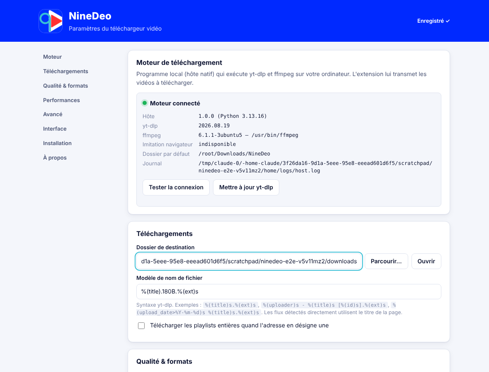
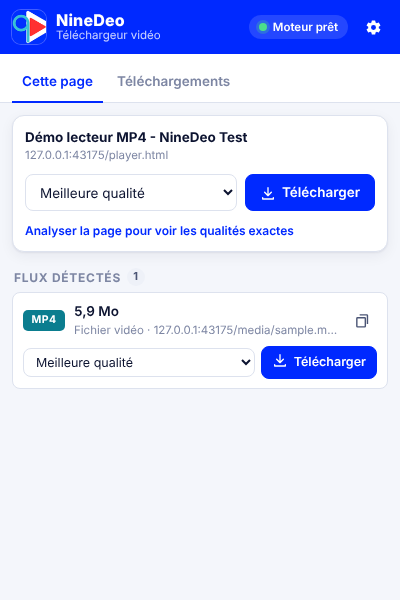
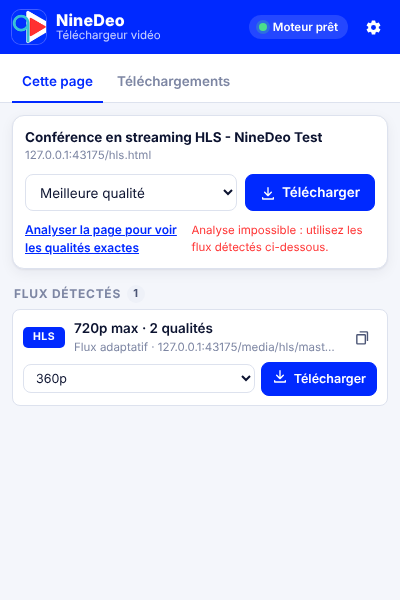
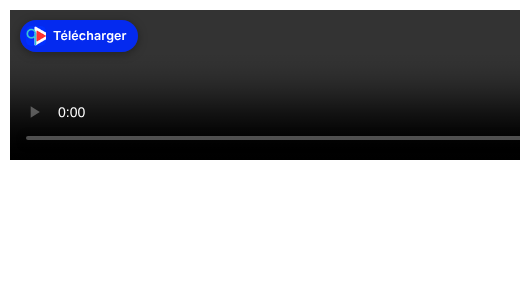
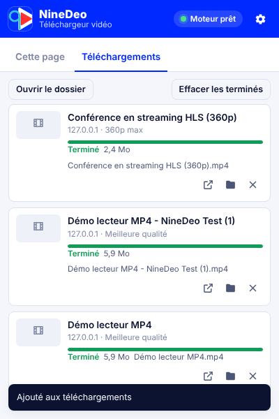
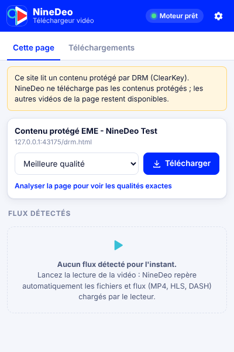

<p align="center"></p>

# NineDeo — Notice d'utilisation

*Version 1.0.0*

NineDeo télécharge les vidéos des sites que vous consultez. L'outil se compose de deux éléments à installer une seule fois :

- **l'extension** : l'icône NineDeo dans la barre du navigateur ;
- **le moteur** : un petit programme qui effectue les téléchargements sur votre ordinateur.

---

## 1. Configuration requise

| | |
|---|---|
| Système | Windows 10 ou 11 (également Linux et macOS) |
| Navigateur | Google Chrome, Microsoft Edge, Brave, Opera, Vivaldi ou Firefox 128+ |
| Logiciels | Python 3.9 ou plus récent (sauf version « exécutable », voir §2.3) |
| Espace disque | ~250 Mo pour le moteur et ffmpeg, plus vos vidéos |
| Connexion | Nécessaire pendant l'installation (téléchargement de yt-dlp et ffmpeg) |

## 2. Installation

### 2.1 Installer le moteur (Windows)

> **Archive téléchargée depuis GitHub (Releases) ?** Le moteur y est déjà compilé : Python n'est **pas** nécessaire, passez directement à l'étape 2.

1. Si Python n'est pas installé : téléchargez-le sur <https://www.python.org/downloads/> et **cochez « Add python.exe to PATH »** pendant l'installation. L'installeur NineDeo peut aussi l'installer pour vous avec `winget`.
2. Ouvrez le dossier `NineDeo\installer\windows`.
3. Double-cliquez sur **`install.bat`**. Aucun droit administrateur n'est demandé.
4. Une fenêtre affiche les étapes : Python, environnement, yt-dlp, ffmpeg (environ 130 Mo à télécharger la première fois), déclaration auprès des navigateurs, auto-test.
5. L'installation est réussie quand « **Installation terminée.** » s'affiche. Appuyez sur une touche pour fermer.

> Si Windows SmartScreen affiche un avertissement, cliquez sur *Informations complémentaires* puis *Exécuter quand même* : le script n'est pas signé.

### 2.2 Ajouter l'extension

**Chrome, Edge, Brave, Opera, Vivaldi**

1. Ouvrez la page des extensions : `chrome://extensions` (Edge : `edge://extensions`).
2. Activez le **Mode développeur** (interrupteur en haut à droite, ou à gauche dans Edge).
3. Cliquez sur **Charger l'extension non empaquetée** et choisissez le dossier `NineDeo\extension`.
4. Épinglez l'icône NineDeo : bouton « puzzle » de la barre d'outils, puis la punaise à côté de NineDeo.

**Firefox**

1. Ouvrez `about:debugging#/runtime/this-firefox`.
2. Cliquez sur **Charger un module complémentaire temporaire…** et choisissez `NineDeo\extension\manifest.json`.
3. Ouvrez `about:addons` → NineDeo → *Permissions* et vérifiez que l'accès à tous les sites est accordé.

> Un module temporaire disparaît à la fermeture de Firefox. Pour une installation durable, l'extension doit être signée par Mozilla (voir la documentation technique, §10.3).

### 2.3 Vérifier la connexion

À l'installation, la page **Paramètres de NineDeo** s'ouvre. Dans la section *Moteur de téléchargement*, cliquez sur **Tester la connexion**. Un voyant vert et « **Moteur connecté** » doivent apparaître, avec les versions de yt-dlp et de ffmpeg.



*Capture réalisée dans l'environnement de test : sous Windows, les chemins affichés seront du type `C:\Users\…\Downloads\NineDeo`.*

**Version sans Python (démonstration sur un autre poste).** Sur un poste disposant de Python, exécutez `installer\windows\build_exe.ps1 -WithFfmpeg` (clic droit → *Exécuter avec PowerShell*). Copiez ensuite tout le dossier NineDeo sur l'autre poste et lancez `install.bat` : l'exécutable est détecté et utilisé automatiquement.

### 2.4 Linux / macOS

```bash
bash installer/unix/install.sh        # installe le moteur et le déclare aux navigateurs
sudo apt install ffmpeg               # ou : brew install ffmpeg
```

Chargez ensuite l'extension comme décrit au §2.2.

---

## 3. Utilisation

### 3.1 Télécharger la vidéo d'une page

1. Ouvrez la page de la vidéo et **lancez la lecture**. Beaucoup de lecteurs ne chargent le flux qu'au démarrage de la lecture.
2. Le **nombre de vidéos détectées** apparaît sur l'icône NineDeo. Cliquez dessus.
3. Deux possibilités dans la popup :
   - **Carte « Cette page »** : choisissez la qualité puis cliquez sur **Télécharger**. NineDeo transmet la page au moteur, qui reconnaît plus de 1 800 sites (titre et qualités exacts). En cas d'échec, il essaie automatiquement les flux détectés.
   - **Liste « Flux détectés »** : chaque fichier ou flux réellement chargé par le lecteur, avec son type (MP4, HLS, DASH), sa qualité maximale, sa durée ou sa taille. Choisissez la qualité puis cliquez sur **Télécharger**.
4. L'onglet **Téléchargements** s'ouvre et affiche la progression.

| Fichier MP4 détecté | Flux HLS à plusieurs qualités |
|---|---|
|  |  |

> **Astuce :** le lien *Analyser la page pour voir les qualités exactes* interroge le moteur sans rien télécharger. La liste des qualités se complète alors avec les **formats exacts** (résolution, codec, taille), utiles pour un choix précis. Si l'analyse échoue (« utilisez les flux détectés »), le site n'est pas reconnu : passez par la liste des flux.

### 3.2 Les qualités proposées

| Choix | Résultat |
|---|---|
| Meilleure qualité | Meilleures pistes vidéo et audio, fusionnées en MP4 |
| 4K, 1440p, 1080p, 720p, 480p, 360p | Meilleure qualité **ne dépassant pas** cette hauteur |
| Audio seul — MP3 / M4A | Piste audio uniquement, convertie |
| Formats exacts (avancé) | Un format précis issu de l'analyse ; l'audio est ajouté si besoin |

### 3.3 Le bouton sur la vidéo

Au survol d'une vidéo, un bouton **Télécharger** apparaît en haut à gauche du lecteur. Un clic lance le téléchargement dans la *qualité par défaut* définie dans les paramètres. Le bouton affiche « Ajouté ✓ » en cas de succès.



Ce bouton se désactive dans *Paramètres → Interface*.

### 3.4 Menu contextuel et raccourcis

- **Clic droit sur une vidéo** → *Télécharger cette vidéo avec NineDeo*.
- **Clic droit sur un lien** (vers une page vidéo ou un fichier) → *Télécharger le lien avec NineDeo*.
- **Clic droit sur la page** → *Télécharger la vidéo de cette page*.
- **Alt + Maj + N** : ouvrir NineDeo. **Alt + Maj + D** : télécharger la vidéo de la page en qualité par défaut. Ces raccourcis se modifient dans `chrome://extensions/shortcuts`.

### 3.5 Suivre et gérer les téléchargements



| Bouton | Action |
|---|---|
| ⏸ Pause | Suspend le téléchargement ; la partie déjà téléchargée est conservée |
| ▶ Reprendre | Reprend là où il s'était arrêté, y compris après un redémarrage du navigateur (état « Interrompu ») |
| ■ Annuler | Arrête le téléchargement et supprime les fichiers partiels |
| ↻ Réessayer | Relance un téléchargement en erreur |
| ↗ Ouvrir | Lit le fichier avec le lecteur par défaut |
| 📁 Dossier | Affiche le fichier dans l'Explorateur |
| ✕ Retirer | Retire la ligne de la liste, sans supprimer le fichier |

En haut de l'onglet : **Ouvrir le dossier** et **Effacer les terminés**. Une notification Windows signale chaque fin de téléchargement : cliquez dessus pour ouvrir la vidéo.

Les fichiers sont enregistrés par défaut dans **Téléchargements\NineDeo**.

### 3.6 Vidéos réservées aux membres connectés

Si une vidéo n'est visible qu'une fois connecté, **connectez-vous au site dans le navigateur**, puis téléchargez normalement : NineDeo transmet automatiquement vos cookies de session au moteur local, sans les enregistrer. Option : *Paramètres → Avancé → Utiliser les cookies du navigateur*.

### 3.7 Contenus protégés (DRM)

Les plateformes comme Netflix, Disney+ ou Prime Video chiffrent leurs vidéos (DRM). NineDeo **ne télécharge pas** ces contenus :

- un bandeau jaune indique que la page lit un contenu protégé ;
- les flux concernés portent un badge rouge **DRM** et un cadenas à la place du bouton.

Les autres vidéos non protégées de la même page restent téléchargeables.



---

## 4. Paramètres

Accès : icône ⚙ de la popup, ou clic droit sur l'icône NineDeo → *Options*. Les modifications sont enregistrées immédiatement (« Enregistré ✓ »).

| Section | Réglage | Par défaut |
|---|---|---|
| Moteur | Tester la connexion, **Mettre à jour yt-dlp** (à faire si un site cesse de fonctionner) | — |
| Téléchargements | Dossier de destination (bouton *Parcourir…*) | `Téléchargements\NineDeo` |
| | Modèle de nom de fichier (syntaxe yt-dlp) | `%(title).180B.%(ext)s` |
| | Télécharger les playlists entières | Non |
| Qualité & formats | Qualité par défaut (bouton sur vidéo, menu, raccourci) | Meilleure |
| | Conteneur MP4 / MKV | MP4 |
| | Format et débit audio | MP3, 192 kb/s |
| | Préférer H.264 + AAC (compatibilité maximale) | Oui |
| | Métadonnées / miniature / sous-titres (langues) | Oui / Non / Non (fr,en) |
| Performances | Téléchargements simultanés | 3 |
| | Segments en parallèle (HLS/DASH) | 4 |
| | Limite de débit (Kio/s) | 0 = illimité |
| Avancé | Cookies du navigateur ; imitation de la signature d'un navigateur | Oui ; Oui |
| Interface | Bouton sur les vidéos ; notifications ; taille minimale des fichiers détectés ; taille de l'historique | Oui ; Oui ; 300 Kio ; 200 |

Exemples de modèles de nom :

- `%(title)s.%(ext)s` → `Ma vidéo.mp4`
- `%(uploader)s - %(title)s.%(ext)s` → `Chaîne - Ma vidéo.mp4`
- `%(upload_date>%Y-%m-%d)s %(title)s.%(ext)s` → `2026-10-17 Ma vidéo.mp4`

---

## 5. Dépannage

| Symptôme | Solution |
|---|---|
| Popup : « **Moteur NineDeo introuvable** » | Lancez `installer\windows\install.bat`, puis rechargez l'extension (`chrome://extensions` → ↻) et cliquez sur *Réessayer*. Les fichiers MP4 directs restent téléchargeables par le navigateur en attendant. |
| « Moteur en erreur » juste après l'installation | Fermez **toutes** les fenêtres du navigateur puis rouvrez-le. Vérifiez l'auto-test (documentation technique, §13.3). |
| Aucun flux détecté | Lancez la lecture de la vidéo, attendez quelques secondes, rouvrez la popup. Rechargez la page si l'extension a été installée après son ouverture. |
| « Analyse impossible » | Le site n'est pas reconnu par le moteur : utilisez la liste « Flux détectés ». |
| « Accès refusé par le serveur (403) » | Le lien a expiré : rechargez la page, relancez la lecture puis le téléchargement. |
| « Le site demande une connexion » | Connectez-vous au site dans le navigateur, vérifiez que l'option *Utiliser les cookies du navigateur* est cochée, puis réessayez. |
| Un site qui fonctionnait ne fonctionne plus | *Paramètres → Moteur → Mettre à jour yt-dlp*. |
| Vidéo sans son, ou audio et vidéo séparés | ffmpeg est absent : relancez l'installeur, ou `winget install Gyan.FFmpeg`. La page Paramètres indique « ffmpeg introuvable » dans ce cas. |
| La vidéo ne se lit pas dans le lecteur Windows | Cochez *Préférer H.264 + AAC*, ou utilisez VLC. |
| Plusieurs vidéos portent le même titre | NineDeo numérote automatiquement : « Titre (2).mp4 ». |
| Bouton absent sur une vidéo | Il n'apparaît pas sur les vidéos de petite taille ni en plein écran. Utilisez la popup ou le clic droit. |

**Journal du moteur** : `%LOCALAPPDATA%\NineDeo\logs\host.log` (chemin affiché dans les Paramètres). Joignez-le à tout signalement de problème.

---

## 6. Désinstallation

1. Moteur : double-cliquez sur `installer\windows\uninstall.bat`. Cela supprime les déclarations dans le registre et le dossier `%LOCALAPPDATA%\NineDeo`. Vos vidéos ne sont pas touchées.
2. Extension : `chrome://extensions` → NineDeo → **Supprimer**.

Sous Linux/macOS : `bash installer/unix/install.sh --uninstall`.

---

## 7. Bon usage

NineDeo est un outil pédagogique. Téléchargez uniquement des vidéos que vous avez le droit de copier : contenus sous licence libre, vos propres vidéos, ou copie privée lorsqu'elle est autorisée. Respectez les conditions d'utilisation des sites. Les contenus protégés par DRM ne sont pas pris en charge.
